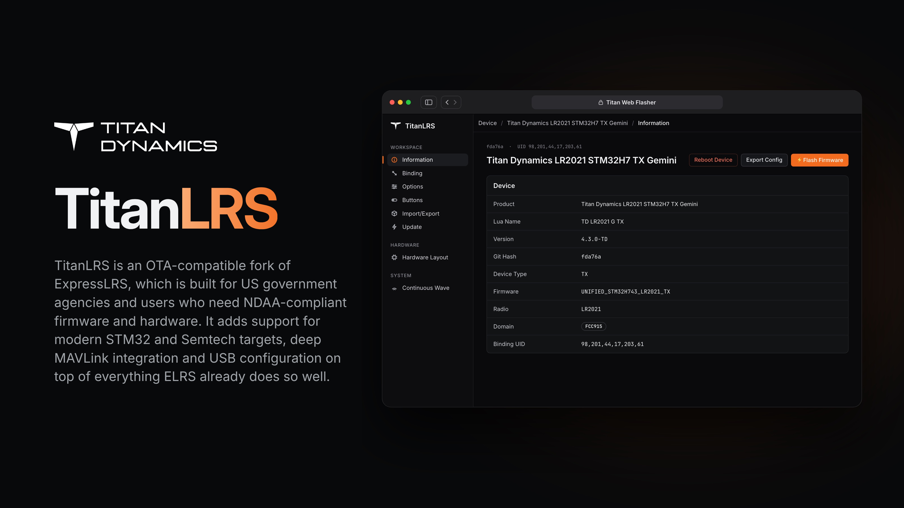

  

  
  
  

**TitanLRS** is Titan Dynamics' fork of [ExpressLRS](https://github.com/ExpressLRS/ExpressLRS) which can be flashed to ELRS or TD hardware using the [TitanLRS Web Flasher](https://titan-dynamics.github.io/TitanLRS-Web-Flasher/). It stays over-the-air compatible with ExpressLRS 4.x and is rebased on upstream regularly, so you get every ExpressLRS improvement when everyone else does. On top of that it adds NDAA-friendly STM32 hardware support, the latest Semtech radio support, and deep MAVLink and USB integration.

# TitanLRS adds:

ExpressLRS dropped support for STM32 in 4.x, and for good reasons. This creates a challenge for US government departments that want to continue using ELRS though, because the ESP chips that ELRS use are manufactured by Espressif, a Chinese company.
That's why most manufacturers selling NDAA-compliant ExpressLRS hardware on the market today run a fork of 3.x, which still had support for STM32. This leaves their customers stuck on an old outdated version, missing all the bugfixes and good stuff that upstream ExpressLRS has shipped since, and with no clear upgrade path.

TitanLRS takes a different approach... This fork brings back support for STM32 for the current v4.x version, with the STM32H743. We regularly rebase on upstream, so that TitanLRS users continue to get the new stuff when everyone else does, along with our feature additions on top.

## LR2021 - The latest and greatest from Semtech!

If you've owned a few generations of ExpressLRS gear, you'll know that not every module can run every packet rate. Your older 900MHz gear tops out at 200Hz packet rate, and can't do the newer 200Hz Full or K1000 rates. Your 2.4GHz gear can run FLRC at F1000 and D500, but the fancy new LR1121 dual-band hardware can't. The packet rates that show up in your Lua depends on which Semtech chip the hardware uses, and no one chip would do all of the modulation types... until now!

Semtech's new LR2021 is the first chip that can do all of them, so one radio will link with every packet rate, on both bands.

TitanLRS supports this new radio on both ESP32 and STM32 targets. 24 packet rates on a single chip, and it links with your existing 900, 2.4 and dual-band receivers at whatever rates they support. It also brings Semtech's latest and greatest RF link performance to TitanLRS.

## It just works

Getting MAVLink from a TX into a ground station can sometimes be a bit fiddly on ELRS. The COM port changes depending on hardware, baud rate needs to match, and the RTS/DTR toggle in Mission Planner usually resets the TX on-connect, so you end up messing with settings for five minutes before you see a feed.

On STM32 targets, the USB port now shows up on the GCS computer as a network adapter, with an IP address, and MAVLink runs over UDP. This means [Titan Planner](https://github.com/Titan-Dynamics/TitanPlanner), Mission Planner, QGC and other GCSs will auto-connect as soon as UDP is detected, without having to select a single thing. It doesn't touch your normal internet connection, and the old USB serial port is still there if you need it.

## Configure, without WiFi

On ESP hardware, many of the TX and RX settings are located in the WebUI which is hosted by the on-chip WiFi. STM32 has no WiFi, and on most of the old v3.x STM32 hardware you were stuck with the settings that appeared in the Lua script, and you had to reflash firmware to change anything else (or miss out on some settings entirely!).

TitanLRS adds a config API for STM32 targets which works over the USB network link. Plug the TX or RX into your laptop, open the Titan Web Flasher in Chrome, and you get the same web UI you'd see on an ESP device, plus a web version of the Lua script for live changes like packet rate and power. You can set up a receiver on the bench with nothing but a USB cable, no handset or WiFi needed.

The flasher can also kick the STM32 into DFU mode for you (similar to something like Betaflight's firmware flasher), so you don't need to hold a boot button while plugging in the cable with your third hand.

## Fly from your laptop - no handset needed

Send CRSF RC channels to the TX over its USB port and it flies exactly as if a handset were plugged into the JR bay. TitanLRS detects the source automatically, with no setting to change. [TitanLRS-Controller](https://github.com/Titan-Dynamics/TitanLRS-Controller) turns a laptop into the handset: plug in a HOTAS, an Xbox controller or any other USB joystick, map it to 16 channels, and get live link stats and full TX and RX Lua settings, all over a single USB cable.

## Parameter protocol for MAVLink

If you fly MAVLink, your aircraft is already set up from the ground station, via parameters. But what about your TitanLRS hardware? Changing packet rate or power meant picking up the handset and digging through the Lua, and if your TX lives on a tripod or mast with no handset attached, you couldn't change it at all.

With TitanLRS, the TX and RX show up in [Titan Planner](https://github.com/Titan-Dynamics/TitanPlanner) / Mission Planner as their own MAVLink components, each with its own parameter list. Packet rate, RF power, etc. display on the Parameters page alongside ArduPilot params. RX settings are changed over the air, same as the Lua.

And because they're ordinary params, you can save them to a file. Set your link up for a long range mission once, save it, and load it before the next one, and you know both ends are configured exactly per the mission requirements.

## Rich link stats via MAVLink

ELRS sends link stats in CRSF format. This means the critical link data (RSSI dBm for both antennas, SNR for both ends of the link, LQ and TLQ, etc.) only went to the handset, and ended up in your EdgeTX logs instead of next to your flight data on the GCS.

In TitanLRS though, the TX sends that rich link data to the ground station too: RSSI in dBm for both antennas, uplink and downlink LQ, SNR, and TX power, using the mLRS link stats message. It's recorded in the tlog, so after a flight you can line up an LQ dip with exactly where the aircraft was and which way it was pointing. You can graph it live in the MAVLink Inspector today, and it sets us up to show it on the [Titan Planner](https://github.com/Titan-Dynamics/TitanPlanner) dashboard in a future update.

## And more

- **Unified targets for STM32:** STM32 hardware uses the same unified targets as ESP, so a new board only needs a JSON layout file, not a firmware release.
- **Refreshed web UI** in the Titan Dynamics theme.
- **Lua from the Backpack's web page:** the [TitanLRS Backpack](https://github.com/Titan-Dynamics/TitanLRS-Backpack) can change TX settings from its WiFi web interface, no handset needed.

## Compatibility

TitanLRS links with ExpressLRS 4.x.

---

## Upstream

TitanLRS is built on [ExpressLRS](https://github.com/ExpressLRS/ExpressLRS), developed and maintained by ExpressLRS LLC and its open source community.

- Website and docs: <https://www.expresslrs.org/>
- Repository: <https://github.com/ExpressLRS/ExpressLRS>
- Community: [Discord](https://discord.gg/expresslrs)
- Support the project: [Open Collective](https://opencollective.com/expresslrs)

TitanLRS is open source under the same license as ExpressLRS, the GNU GPL v3. See [LICENSE](LICENSE).
